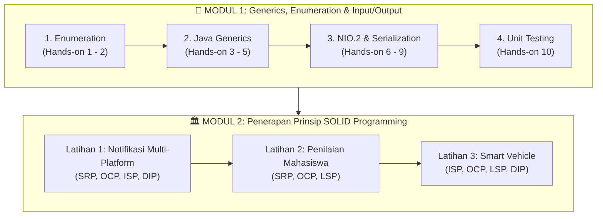
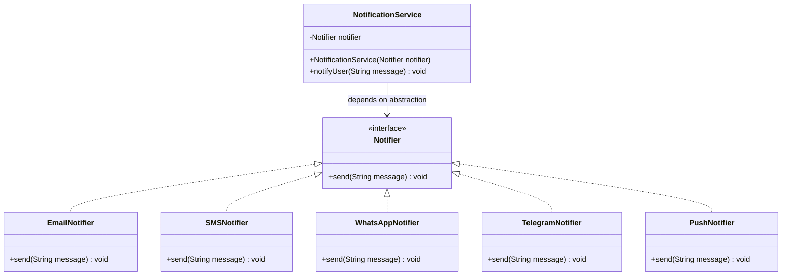
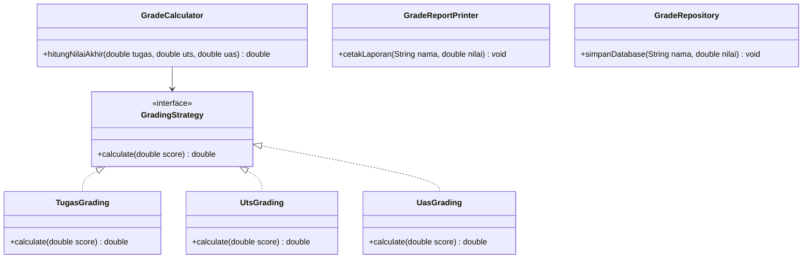
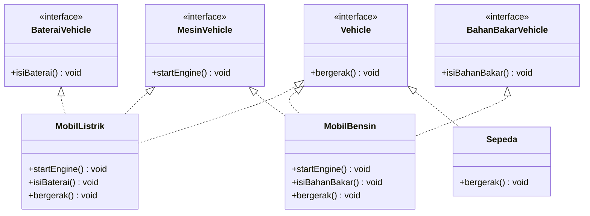

<div align="center">

# ☕ Hands-On OOP: Generics, Enumeration, I/O & SOLID Programming (Java)

[](https://www.oracle.com/java/)
[](#)
[](#-eksplorasi-interaktif-penerapan-solid-programming-latihan-1--3)
[](#)
[](#)

[-EC1C24?style=for-the-badge&logo=adobeacrobatreader&logoColor=white)](./docs/Modul_Hands_On_Generics_Enum_IO.pdf)
[-D9381E?style=for-the-badge&logo=adobeacrobatreader&logoColor=white)](./docs/Modul_Hands_On_Penerapan_SOLID_Programming.pdf)

**Repositori Praktikum & Latihan Pemrograman Berorientasi Objek (OOP)**  
Implementasi lengkap **10 Modul Hands-On Generics, Enumeration, & Input/Output** serta **3 Studi Kasus & Latihan Penerapan Prinsip SOLID (SRP, OCP, LSP, ISP, DIP)** dalam bahasa Java.

[📄 **Dokumen Modul PDF**](#-dokumen-modul-praktikum-pdf) · [📊 **Tabel Navigasi Cepat**](#-ringkasan-navigasi-modul) · [📘 **Hands-On 1–10**](#-eksplorasi-interaktif-hands-on-1--10-generics-enum--io) · [🏛️ **SOLID Latihan 1–3**](#-eksplorasi-interaktif-penerapan-solid-programming-latihan-1--3) · [🚀 **Cara Menjalankan**](#-panduan-kompilasi--eksekusi)

</div>

---

## 📌 Daftar Isi

- [🗺️ Peta Konsep & Arsitektur Pembelajaran](#️-peta-konsep--arsitektur-pembelajaran)
- [📄 Dokumen Modul Praktikum (PDF)](#-dokumen-modul-praktikum-pdf)
- [📊 Ringkasan Navigasi Modul](#-ringkasan-navigasi-modul)
- [📂 Struktur Direktori Proyek](#-struktur-direktori-proyek)
- [📘 Eksplorasi Interaktif: Hands-On 1 – 10 (Generics, Enum & I/O)](#-eksplorasi-interaktif-hands-on-1--10-generics-enum--io)
  - [Hands-on 1: Enum: Tipe Bank Account](#1️⃣-enum-tipe-bank-account-hands-on-1)
  - [Hands-on 2: Enum dengan Konstruktor](#2️⃣-enum-dengan-konstruktor-hands-on-2)
  - [Hands-on 3: Generic Class](#3️⃣-generic-class-hands-on-3)
  - [Hands-on 4: Generic Class Multi-Tipe](#4️⃣-generic-class-multi-tipe-hands-on-4)
  - [Hands-on 5: Generic Method](#5️⃣-generic-method-hands-on-5)
  - [Hands-on 6: Reading Text File (Pre vs NIO.2)](#6️⃣-reading-text-file-pre-vs-nio2-hands-on-6)
  - [Hands-on 7: Write and Copy Files](#7️⃣-write-and-copy-files-hands-on-7)
  - [Hands-on 8: Try-with-Resources & Stream](#8️⃣-try-with-resources--stream-hands-on-8)
  - [Hands-on 9: Serialization](#9️⃣-serialization-hands-on-9)
  - [Hands-on 10: Unit Testing (JUnit)](#🔟-unit-testing-junit-hands-on-10)
- [🏛️ Eksplorasi Interaktif: Penerapan SOLID Programming (Latihan 1 – 3)](#️-eksplorasi-interaktif-penerapan-solid-programming-latihan-1--3)
  - [SOLID Latihan 1: Notifikasi Multi-Platform (SRP, OCP, ISP, DIP)](#1️⃣-notifikasi-multi-platform-solid---latihan-1)
  - [SOLID Latihan 2: Penilaian Mahasiswa (SRP, OCP, LSP)](#2️⃣-penilaian-mahasiswa-solid---latihan-2)
  - [SOLID Latihan 3: Smart Vehicle (ISP, OCP, LSP, DIP)](#3️⃣-smart-vehicle-solid---latihan-3)
- [🚀 Panduan Kompilasi & Eksekusi](#-panduan-kompilasi--eksekusi)

---

## 🗺️ Peta Konsep & Arsitektur Pembelajaran

Diagram berikut menggambarkan alur materi yang dipelajari dan diimplementasikan pada repositori ini:



---

## 📄 Dokumen Modul Praktikum (PDF)

Seluruh dokumen soal asli tersimpan rapi di dalam direktori [`docs/`](./docs):

| No | Nama Dokumen Modul | Topik Bahasan | Tautan File PDF |
|:--:|:---|:---|:---|
| **1** | **Modul Hands-On Generics, Enumeration, dan I/O** | Hands-on 1 s.d. Hands-on 10 beserta Latihan | [📄 Buka PDF](./docs/Modul_Hands_On_Generics_Enum_IO.pdf) |
| **2** | **Modul Hands-On Penerapan SOLID Programming** | Case 1–3 & Latihan 1–3 (Notifikasi, Penilaian, Smart Vehicle) | [📄 Buka PDF](./docs/Modul_Hands_On_Penerapan_SOLID_Programming.pdf) |

---

## 📊 Ringkasan Navigasi Modul

### A. Modul 1: Generics, Enumeration, dan Input/Output (Hands-on 1 – 10)

| No | Topik Hands-On | Konsep Utama | Direktori Modul | Kode Sumber (`src/`) | Data / Output (`data/`) |
|:--:|:---|:---|:---|:---|:---|
| **01** | **Enum: Tipe Bank Account** | `enum`, `values()`, Override `toString()` | [📂 Folder](./Enum%EF%BC%9A%20Tipe%20Bank%20Account%20(Hands-on%201)) | [`Account.java`](./Enum%EF%BC%9A%20Tipe%20Bank%20Account%20(Hands-on%201)/src/Account.java) | — |
| **02** | **Enum dengan Konstruktor** | Private Constructor, `code` & `interestRate` | [📂 Folder](./Enum%20dengan%20Konstruktor%20(Hands-on%202)) | [`EnumConstructorDemo.java`](./Enum%20dengan%20Konstruktor%20(Hands-on%202)/src/EnumConstructorDemo.java) | — |
| **03** | **Generic Class** | Type Parameter `<T>`, Compile-Time Safety | [📂 Folder](./Generic%20Class%20(Hands-on%203)) | [`Cell.java`](./Generic%20Class%20(Hands-on%203)/src/Cell.java) | — |
| **04** | **Generic Class Multi-Tipe** | Multi-Type `<T1, T2>`, Method `swap()` | [📂 Folder](./Generic%20Class%20Multi-Tipe%20(Hands-on%204)) | [`Pair.java`](./Generic%20Class%20Multi-Tipe%20(Hands-on%204)/src/Pair.java) | — |
| **05** | **Generic Method** | `<T extends Comparable<T>>`, Type Inference | [📂 Folder](./Generic%20Method%20(Hands-on%205)) | [`CompareUtil.java`](./Generic%20Method%20(Hands-on%205)/src/CompareUtil.java) | — |
| **06** | **Reading Text File (Pre vs NIO.2)** | `Path`, `Files.newBufferedReader`, `ArrayList` | [📂 Folder](./Reading%20Text%20File%20(Pre%20vs%20NIO.2)%20(Hands-on%206)) | [`ReadEmployeeFile.java`](./Reading%20Text%20File%20(Pre%20vs%20NIO.2)%20(Hands-on%206)/src/ReadEmployeeFile.java) | [`employees.txt`](./Reading%20Text%20File%20(Pre%20vs%20NIO.2)%20(Hands-on%206)/data/employees.txt)<br>[`copy_employees.txt`](./Reading%20Text%20File%20(Pre%20vs%20NIO.2)%20(Hands-on%206)/data/copy_employees.txt) |
| **07** | **Write and Copy Files** | `Files.write`, `Files.exists`, `Files.copy` | [📂 Folder](./Write%20and%20Copy%20Files%20(Hands-on%207)) | [`FileCopyNew.java`](./Write%20and%20Copy%20Files%20(Hands-on%207)/src/FileCopyNew.java) | [`report.txt`](./Write%20and%20Copy%20Files%20(Hands-on%207)/data/report.txt)<br>[`log.txt`](./Write%20and%20Copy%20Files%20(Hands-on%207)/data/log.txt) |
| **08** | **Try-with-Resources & Stream** | Auto-Closeable Resource, Loop `exit`, Timestamp | [📂 Folder](./Try-with-Resources%20&%20Stream%20(Hands-on%208)) | [`WriteUserInputNew.java`](./Try-with-Resources%20&%20Stream%20(Hands-on%208)/src/WriteUserInputNew.java) | [`user_input.txt`](./Try-with-Resources%20&%20Stream%20(Hands-on%208)/data/user_input.txt) |
| **09** | **Serialization** | `Serializable`, `ObjectOutputStream`, `deserialize()` | [📂 Folder](./Serialization%20(Hands-on%209)) | [`SerializeDemo.java`](./Serialization%20(Hands-on%209)/src/SerializeDemo.java) | [`emp.ser`](./Serialization%20(Hands-on%209)/data/emp.ser)<br>[`employees_list.ser`](./Serialization%20(Hands-on%209)/data/employees_list.ser) |
| **10** | **Unit Testing (JUnit)** | `Produk<T, U, V>`, `Files.readAllLines`, Unit Test | [📂 Folder](./Unit%20Testing%20(JUnit)%20(Hands-on%2010)) | [`Produk.java`](./Unit%20Testing%20(JUnit)%20(Hands-on%2010)/src/Produk.java)<br>[`ProdukWriterNew.java`](./Unit%20Testing%20(JUnit)%20(Hands-on%2010)/src/ProdukWriterNew.java)<br>[`ProdukWriterTest.java`](./Unit%20Testing%20(JUnit)%20(Hands-on%2010)/src/ProdukWriterTest.java) | [`produk_output.txt`](./Unit%20Testing%20(JUnit)%20(Hands-on%2010)/data/produk_output.txt)<br>[`pelanggan_output.txt`](./Unit%20Testing%20(JUnit)%20(Hands-on%2010)/data/pelanggan_output.txt)<br>[`transaksi_output.txt`](./Unit%20Testing%20(JUnit)%20(Hands-on%2010)/data/transaksi_output.txt) |

### B. Modul 2: Penerapan SOLID Programming (Latihan 1 – 3)

| No | Topik Studi Kasus / Latihan | Prinsip SOLID Utama | Fokus Desain & Solusi | Direktori Modul | Kode Sumber (`src/`) |
|:--:|:---|:---|:---|:---|:---|
| **01** | **Notifikasi Multi-Platform** | **SRP, OCP, ISP, DIP** | Abstraksi `Notifier` & pemisahan kelas kanal (`Email`, `SMS`, `WhatsApp`, `Telegram`, `Push`) | [📂 Folder](./Notifikasi%20Multi-Platform%20(SOLID%20-%20Latihan%201)) | [`Main.java`](./Notifikasi%20Multi-Platform%20(SOLID%20-%20Latihan%201)/src/Main.java) |
| **02** | **Penilaian Mahasiswa** | **SRP, OCP, LSP** | Pemisahan `GradeCalculator`, `GradeReportPrinter`, dan `GradeRepository` + `GradingStrategy` | [📂 Folder](./Penilaian%20Mahasiswa%20(SOLID%20-%20Latihan%202)) | [`Main.java`](./Penilaian%20Mahasiswa%20(SOLID%20-%20Latihan%202)/src/Main.java) |
| **03** | **Smart Vehicle** | **ISP, OCP, LSP, DIP** | Segregasi interface (`Vehicle`, `MesinVehicle`, `BahanBakarVehicle`, `BateraiVehicle`) | [📂 Folder](./Smart%20Vehicle%20(SOLID%20-%20Latihan%203)) | [`Main.java`](./Smart%20Vehicle%20(SOLID%20-%20Latihan%203)/src/Main.java) |

---

## 📂 Struktur Direktori Proyek

Setiap modul dipisahkan ke dalam direktorinya masing-masing dengan struktur standar `src/` (kode sumber), `out/` (bytecode `.class`), dan `data/` (berkas I/O):

```text
📦 Hands On Generic Input Output
 ┣ 📂 docs
 ┃ ┣ 📄 Modul_Hands_On_Generics_Enum_IO.pdf                  # Modul 1: Generics, Enum & I/O
 ┃ ┗ 📄 Modul_Hands_On_Penerapan_SOLID_Programming.pdf       # Modul 2: Penerapan SOLID Programming
 ┃
 ┣ 📂 Enum： Tipe Bank Account (Hands-on 1)
 ┃ ┣ 📂 src/Account.java
 ┃ ┗ 📂 out/
 ┣ 📂 Enum dengan Konstruktor (Hands-on 2)
 ┃ ┣ 📂 src/EnumConstructorDemo.java
 ┃ ┗ 📂 out/
 ┣ 📂 Generic Class (Hands-on 3)
 ┃ ┣ 📂 src/Cell.java
 ┃ ┗ 📂 out/
 ┣ 📂 Generic Class Multi-Tipe (Hands-on 4)
 ┃ ┣ 📂 src/Pair.java
 ┃ ┗ 📂 out/
 ┣ 📂 Generic Method (Hands-on 5)
 ┃ ┣ 📂 src/CompareUtil.java
 ┃ ┗ 📂 out/
 ┣ 📂 Reading Text File (Pre vs NIO.2) (Hands-on 6)
 ┃ ┣ 📂 src/ReadEmployeeFile.java
 ┃ ┣ 📂 data/ (employees.txt, copy_employees.txt)
 ┃ ┗ 📂 out/
 ┣ 📂 Write and Copy Files (Hands-on 7)
 ┃ ┣ 📂 src/FileCopyNew.java
 ┃ ┣ 📂 data/ (report.txt, log.txt, backup/report.txt)
 ┃ ┗ 📂 out/
 ┣ 📂 Try-with-Resources & Stream (Hands-on 8)
 ┃ ┣ 📂 src/WriteUserInputNew.java
 ┃ ┣ 📂 data/user_input.txt
 ┃ ┗ 📂 out/
 ┣ 📂 Serialization (Hands-on 9)
 ┃ ┣ 📂 src/SerializeDemo.java
 ┃ ┣ 📂 data/ (emp.ser, employees_list.ser)
 ┃ ┗ 📂 out/
 ┣ 📂 Unit Testing (JUnit) (Hands-on 10)
 ┃ ┣ 📂 src/ (Produk.java, ProdukWriterNew.java, ProdukWriterTest.java)
 ┃ ┣ 📂 data/ (produk_output.txt, pelanggan_output.txt, transaksi_output.txt)
 ┃ ┗ 📂 out/
 ┃
 ┣ 📂 Notifikasi Multi-Platform (SOLID - Latihan 1)
 ┃ ┣ 📂 src/Main.java
 ┃ ┗ 📂 out/
 ┣ 📂 Penilaian Mahasiswa (SOLID - Latihan 2)
 ┃ ┣ 📂 src/Main.java
 ┃ ┗ 📂 out/
 ┣ 📂 Smart Vehicle (SOLID - Latihan 3)
 ┃ ┣ 📂 src/Main.java
 ┃ ┗ 📂 out/
 ┃
 ┗ 📄 README.md                                              # Dokumentasi Utama
```

---

## 📘 Eksplorasi Interaktif: Hands-On 1 – 10 (Generics, Enum & I/O)

> [!TIP]
> Klik pada panel **`▶ Lihat ...`** di bawah tiap modul untuk membuka detail kode, penjelasan konsep, dan output program!

### 1️⃣ Enum: Tipe Bank Account (Hands-on 1)
- **Latihan:** Tambahkan `DEPOSIT` sebagai tipe baru, buat `toString()` deskriptif, dan uji di `main()`.
<details>
<summary><b>▶ Lihat Transformasi Kode & Output Konsol (Hands-on 1)</b></summary>
<br>

```java
enum AccountType {
    SAVINGS {
        @Override
        public String toString() { return "Savings Account (Rekening Tabungan)"; }
    },
    CREDIT {
        @Override
        public String toString() { return "Credit Account (Rekening Kredit)"; }
    },
    DEPOSIT {
        @Override
        public String toString() { return "Deposit Account (Rekening Deposito)"; }
    }
}
```
**Output Program:**
```text
=== Hands-on 1: Enum: Tipe Bank Account ===

Daftar Semua Tipe Enum:
- SAVINGS -> Savings Account (Rekening Tabungan)
- CREDIT -> Credit Account (Rekening Kredit)
- DEPOSIT -> Deposit Account (Rekening Deposito)

Uji Objek Account:
Account [Tipe = SAVINGS, Deskripsi = Savings Account (Rekening Tabungan)]
Account [Tipe = CREDIT, Deskripsi = Credit Account (Rekening Kredit)]
Account [Tipe = DEPOSIT, Deskripsi = Deposit Account (Rekening Deposito)]
```
🔗 **File Sumber:** [`Enum： Tipe Bank Account (Hands-on 1)/src/Account.java`](./Enum%EF%BC%9A%20Tipe%20Bank%20Account%20(Hands-on%201)/src/Account.java)
</details>

---

### 2️⃣ Enum dengan Konstruktor (Hands-on 2)
- **Latihan:** Tambahkan atribut `interestRate`, tampilkan nama, kode, dan suku bunga dengan perulangan.
<details>
<summary><b>▶ Lihat Implementasi Kode & Output Konsol (Hands-on 2)</b></summary>
<br>

```java
enum AccountType {
    SAVINGS("SA", 2.5),
    CREDIT("CR", 15.0),
    DEPOSIT("DP", 5.5);

    private String code;
    private double interestRate;

    private AccountType(String code, double interestRate) {
        this.code = code;
        this.interestRate = interestRate;
    }

    public String getCode() { return code; }
    public double getInterestRate() { return interestRate; }
}
```
**Output Program:**
```text
=== Hands-on 2: Enum dengan Konstruktor ===
Nama: SAVINGS    | Kode: SA   | Suku Bunga: 2.50%
Nama: CREDIT     | Kode: CR   | Suku Bunga: 15.00%
Nama: DEPOSIT    | Kode: DP   | Suku Bunga: 5.50%
```
🔗 **File Sumber:** [`Enum dengan Konstruktor (Hands-on 2)/src/EnumConstructorDemo.java`](./Enum%20dengan%20Konstruktor%20(Hands-on%202)/src/EnumConstructorDemo.java)
</details>

---

### 3️⃣ Generic Class (Hands-on 3)
- **Latihan:** Buat `Cell<Integer>` dan `Cell<String>`, tambahkan `displayType()`, dan jelaskan keuntungan *generic type safety*.
<details>
<summary><b>▶ Lihat Jawaban Konsep & Output Konsol (Hands-on 3)</b></summary>
<br>

**💡 Keuntungan Generic Type Safety:**
1. **Compile-Time Type Checking:** Mencegah kesalahan tipe data sejak tahap kompilasi sehingga bebas dari `ClassCastException` saat *runtime*.
2. **Tanpa Explicit Casting:** Tidak perlu melakukan *type casting* manual ketika mengambil nilai dari objek.
3. **Code Reusability:** Satu class `Cell<T>` dapat digunakan untuk berbagai tipe data.

**Output Program:**
```text
=== Hands-on 3: Generic Class ===
Tipe data: java.lang.Integer | Nilai: 100
Tipe data: java.lang.String | Nilai: Belajar Java Generics
```
🔗 **File Sumber:** [`Generic Class (Hands-on 3)/src/Cell.java`](./Generic%20Class%20(Hands-on%203)/src/Cell.java)
</details>

---

### 4️⃣ Generic Class Multi-Tipe (Hands-on 4)
- **Latihan:** Buat `Pair<Integer, String>` dan `Pair<Double, Boolean>`, serta tambahkan method `swap()` untuk menukar nilai.
<details>
<summary><b>▶ Lihat Implementasi Method swap() & Output Konsol (Hands-on 4)</b></summary>
<br>

```java
public Pair<T2, T1> swap() {
    return new Pair<>(this.second, this.first);
}
```
**Output Program:**
```text
=== Hands-on 4: Generic Class Multi-Tipe ===
Sebelum swap pair1 : Pair(101, Budi Santoso)
Tipe: java.lang.Integer & java.lang.String
Sesudah swap pair1 : Pair(Budi Santoso, 101)
Tipe: java.lang.String & java.lang.Integer

Sebelum swap pair2 : Pair(98.5, true)
Tipe: java.lang.Double & java.lang.Boolean
Sesudah swap pair2 : Pair(true, 98.5)
Tipe: java.lang.Boolean & java.lang.Double
```
🔗 **File Sumber:** [`Generic Class Multi-Tipe (Hands-on 4)/src/Pair.java`](./Generic%20Class%20Multi-Tipe%20(Hands-on%204)/src/Pair.java)
</details>

---

### 5️⃣ Generic Method (Hands-on 5)
- **Latihan:** Tambahkan *test case* untuk `Double` dan `Character`, serta jelaskan perbedaan *generic class* dan *generic method*.
<details>
<summary><b>▶ Lihat Perbedaan Konsep & Output Konsol (Hands-on 5)</b></summary>
<br>

| Aspek | Generic Class (`class Cell<T>`) | Generic Method (`<T> boolean isEqual(T a, T b)`) |
|:---|:---|:---|
| **Scope Parameter `<T>`** | Berlaku untuk seluruh atribut & *non-static method* di dalam class. | Hanya berlaku lokal pada method tempat `<T>` dideklarasikan. |
| **Dukungan `static`** | Parameter tipe class tidak bisa dipakai oleh `static` method. | Dapat dideklarasikan sebagai `static` method. |
| **Penentuan Tipe** | Ditentukan saat instansiasi objek (`new Cell<String>()`). | Otomatis dikenali (*type inference*) dari argumen pemanggilan. |

**Output Program:**
```text
=== Hands-on 5: Generic Method ===
Integer (5, 5)           : true
String ("Hello", "World"): false
Double (3.14, 3.14)      : true
Double (3.14, 2.71)      : false
Character ('A', 'A')     : true
Character ('A', 'B')     : false
```
🔗 **File Sumber:** [`Generic Method (Hands-on 5)/src/CompareUtil.java`](./Generic%20Method%20(Hands-on%205)/src/CompareUtil.java)
</details>

---

### 6️⃣ Reading Text File (Pre vs NIO.2) (Hands-on 6)
- **Latihan:** Deteksi jika file tidak ditemukan, simpan hasil baca ke `ArrayList<String>`, dan tuliskan ke `copy_employees.txt`.
<details>
<summary><b>▶ Lihat Output Konsol (Hands-on 6)</b></summary>
<br>

```text
=== Hands-on 6: Reading Text File (NIO.2) ===
Berhasil membaca 4 baris dari data\employees.txt:
 - 101, Andi Pratama, IT Department
 - 102, Siti Aminah, Finance
 - 103, Budi Santoso, Human Resources
 - 104, Dewi Lestari, Marketing

Data berhasil disalin ke file baru: data\copy_employees.txt
```
🔗 **File Sumber:** [`Reading Text File (Pre vs NIO.2) (Hands-on 6)/src/ReadEmployeeFile.java`](./Reading%20Text%20File%20(Pre%20vs%20NIO.2)%20(Hands-on%206)/src/ReadEmployeeFile.java)
</details>

---

### 7️⃣ Write and Copy Files (Hands-on 7)
- **Latihan:** Tambahkan pengecekan file sebelum menyalin (`Files.exists()`) dan buat log hasil operasi ke `log.txt`.
<details>
<summary><b>▶ Lihat Isi Log & Output Konsol (Hands-on 7)</b></summary>
<br>

```text
=== Hands-on 7: Write and Copy Files (NIO.2) ===
[2026-11-13 15:46:54] INFO: File sumber 'data/report.txt' berhasil dibuat.
[2026-11-13 15:46:54] INFO: Pengecekan Files.exists(source) bernilai TRUE. Melanjutkan proses salin.
[2026-11-13 15:46:54] INFO: Direktori 'data\backup' berhasil dibuat.
[2026-11-13 15:46:54] SUCCESS: Backup berhasil dibuat di 'data\backup\report.txt'.
Log operasi berhasil disimpan ke: data\log.txt
```
🔗 **File Sumber:** [`Write and Copy Files (Hands-on 7)/src/FileCopyNew.java`](./Write%20and%20Copy%20Files%20(Hands-on%207)/src/FileCopyNew.java)
</details>

---

### 8️⃣ Try-with-Resources & Stream (Hands-on 8)
- **Latihan:** Ubah agar menulis beberapa baris hingga pengguna mengetik `exit` dan tambahkan *timestamp* pada setiap baris.
<details>
<summary><b>▶ Lihat Hasil File Output (Hands-on 8)</b></summary>
<br>

**Isi `data/user_input.txt`:**
```text
[2026-11-13 15:46:54] Baris pertama
[2026-11-13 15:46:54] Baris kedua
```
🔗 **File Sumber:** [`Try-with-Resources & Stream (Hands-on 8)/src/WriteUserInputNew.java`](./Try-with-Resources%20&%20Stream%20(Hands-on%208)/src/WriteUserInputNew.java)
</details>

---

### 9️⃣ Serialization (Hands-on 9)
- **Latihan:** Tambahkan method `deserialize()` untuk membaca kembali objek dan uji dengan beberapa objek berbeda.
<details>
<summary><b>▶ Lihat Output Konsol (Hands-on 9)</b></summary>
<br>

```text
=== Hands-on 9: Serialization ===
Serialized successfully to data/emp.ser
Deserialized single object: John, 30

--- Uji dengan Beberapa Objek Berbeda ---
Serialized successfully to data/employees_list.ser
Deserialized multiple objects:
 - Employee{name='John', age=30}
 - Employee{name='Alice', age=25}
 - Employee{name='Bob', age=40}
 - Employee{name='Siti', age=28}
```
🔗 **File Sumber:** [`Serialization (Hands-on 9)/src/SerializeDemo.java`](./Serialization%20(Hands-on%209)/src/SerializeDemo.java)
</details>

---

### 🔟 Unit Testing (JUnit) (Hands-on 10)
- **Latihan:** Tambahkan atribut `stok` (`Integer`), baca kembali isi file dengan `Files.readAllLines()`, gunakan untuk jenis data lain (pelanggan & transaksi), dan jalankan unit test.
<details>
<summary><b>▶ Lihat Output Program & Hasil Unit Test (Hands-on 10)</b></summary>
<br>

```text
=== Menjalankan Unit Testing Hands-on 10 ===
[PASS] testProdukToString
[PASS] testSimpanDanBacaFileProduk
[PASS] testSimpanDataPelanggan
Semua Unit Test BERHASIL (3/3 passed)!
```
🔗 **File Sumber:**
- [`Unit Testing (JUnit) (Hands-on 10)/src/Produk.java`](./Unit%20Testing%20(JUnit)%20(Hands-on%2010)/src/Produk.java)
- [`Unit Testing (JUnit) (Hands-on 10)/src/ProdukWriterNew.java`](./Unit%20Testing%20(JUnit)%20(Hands-on%2010)/src/ProdukWriterNew.java)
- [`Unit Testing (JUnit) (Hands-on 10)/src/ProdukWriterTest.java`](./Unit%20Testing%20(JUnit)%20(Hands-on%2010)/src/ProdukWriterTest.java)
</details>

---

## 🏛️ Eksplorasi Interaktif: Penerapan SOLID Programming (Latihan 1 – 3)

Bagian ini merupakan penyelesaian lengkap dari **Modul Hands-On: Penerapan SOLID Programming** ([lihat PDF](./docs/Modul_Hands_On_Penerapan_SOLID_Programming.pdf)).

---

### 1️⃣ Notifikasi Multi-Platform (SOLID - Latihan 1)

- **Deskripsi Kasus:** Sistem notifikasi mengirim pesan melalui beberapa platform (Email, SMS, WhatsApp). Pada desain awal, semua metode (`sendEmail`, `sendSMS`, `sendWhatsApp`) dikumpulkan dalam satu kelas besar `NotificationService`, sehingga sulit menambah kanal baru seperti Telegram atau Push Notification.
- **Pertanyaan & Jawaban Analisis:**
  1. **Prinsip SOLID apa saja yang dilanggar oleh kode tersebut?**
     - **Single Responsibility Principle (SRP):** Satu kelas `NotificationService` menangani logika pengiriman untuk seluruh platform sekaligus.
     - **Open-Closed Principle (OCP):** Setiap kali ingin menambah kanal baru (misal Telegram / Push Notification), developer terpaksa memodifikasi kelas `NotificationService` yang sudah ada.
     - **Interface Segregation Principle (ISP) & Dependency Inversion Principle (DIP):** Klien bergantung langsung pada satu kelas konkret yang menggabungkan banyak metode spesifik platform, bukan pada abstraksi yang ringkas.
  2. **Solusi apa yang harus dilakukan agar sesuai dengan kaidah OCP dan ISP?**
     - **Sesuai ISP:** Membuat interface ramping dan spesifik `Notifier` yang hanya memiliki satu kontrak metode `void send(String message)`.
     - **Sesuai OCP & DIP:** Memisahkan setiap kanal menjadi kelas mandiri (`EmailNotifier`, `SMSNotifier`, `WhatsAppNotifier`, `TelegramNotifier`, `PushNotifier`) yang mengimplementasikan `Notifier`. Kelas `NotificationService` cukup bergantung pada interface `Notifier`.

<details>
<summary><b>▶ Lihat Diagram Class, Kode Refactoring & Output (SOLID - Latihan 1)</b></summary>
<br>



**Output Program (`Main.java`):**
```text
=== SOLID Latihan 1: Notifikasi Multi-Platform ===

Mengirim Email: Halo, ini email test!
Mengirim SMS: Ini SMS test!
Mengirim WhatsApp: Ini pesan WhatsApp test!
Mengirim Telegram: Pengumuman akademik via Telegram!
Mengirim Push Notification: Notifikasi baru di aplikasi mobile kampus!
```
🔗 **File Sumber:** [`Notifikasi Multi-Platform (SOLID - Latihan 1)/src/Main.java`](./Notifikasi%20Multi-Platform%20(SOLID%20-%20Latihan%201)/src/Main.java)
</details>

---

### 2️⃣ Penilaian Mahasiswa (SOLID - Latihan 2)

- **Deskripsi Kasus:** Aplikasi kampus memiliki fitur untuk **menghitung nilai akhir mahasiswa**, **mencetak laporan nilai**, dan **menyimpannya ke database**. Awalnya semua logika tersebut digabung ke dalam satu kelas `StudentGrader`.
- **Pertanyaan & Jawaban Analisis:**
  1. **Prinsip SOLID apa yang dilanggar dalam kode ini?**
     - **Single Responsibility Principle (SRP):** Kelas `StudentGrader` memikul **3 tanggung jawab (aktor perubahan) yang berbeda** sekaligus: logika bisnis perhitungan akademik, format tampilan/pencetakan laporan, dan persistensi database.
     - **Open-Closed Principle (OCP):** Rumus komponen penilaian ditulis kaku di dalam satu metode.
  2. **Solusi apa yang sebaiknya dilakukan agar kode lebih mudah dipelihara sesuai dengan SRP?**
     - Memecah `StudentGrader` menjadi tiga kelas terpisah yang masing-masing hanya memiliki satu alasan untuk berubah:
       1. `GradeCalculator` (menggunakan `GradingStrategy` untuk menghitung nilai akhir)
       2. `GradeReportPrinter` (khusus mencetak laporan nilai mahasiswa)
       3. `GradeRepository` (khusus menyimpan nilai ke database)

<details>
<summary><b>▶ Lihat Diagram Class, Kode Refactoring & Output (SOLID - Latihan 2)</b></summary>
<br>



**Output Program (`Main.java`):**
```text
=== SOLID Latihan 2: Penilaian Mahasiswa ===

Laporan Nilai Mahasiswa: Andi = 85.5
Menyimpan ke database: Andi = 85.5
```
🔗 **File Sumber:** [`Penilaian Mahasiswa (SOLID - Latihan 2)/src/Main.java`](./Penilaian%20Mahasiswa%20(SOLID%20-%20Latihan%202)/src/Main.java)
</details>

---

### 3️⃣ Smart Vehicle (SOLID - Latihan 3)

- **Deskripsi Kasus:** Sistem *smart vehicle* mengelola berbagai jenis kendaraan seperti **mobil listrik**, **mobil bensin**, dan **sepeda**. Pada kode awal, semua kendaraan menggunakan satu kelas `Vehicle` yang memiliki metode `startEngine()`, `isiBahanBakar()`, dan `isiBaterai()`, sehingga objek `sepeda` ikut memanggil `startEngine()` padahal sepeda tidak memiliki mesin.
- **Pertanyaan & Jawaban Analisis:**
  1. **Prinsip SOLID apa yang dilanggar oleh desain tersebut?**
     - **Interface Segregation Principle (ISP) & Single Responsibility Principle (SRP):** Semua perilaku kendaraan yang tidak relevan digabung paksa dalam satu kelas/kontrak `Vehicle`.
     - **Liskov Substitution Principle (LSP):** Subtipe/instans `Sepeda` tidak dapat menggantikan `Vehicle` secara valid karena pemanggilan `sepeda.startEngine()` tidak masuk akal dan memicu bug/exception saat *runtime*.
     - **Open-Closed Principle (OCP):** Menambah jenis kendaraan baru dengan kemampuan unik mengharuskan pengubahan kelas `Vehicle`.
  2. **Solusi sesuai Interface Segregation Principle (ISP):**
     - Memisahkan kemampuan kendaraan menjadi interface kecil yang spesifik:
       - `Vehicle` (`void bergerak()`)
       - `MesinVehicle` (`void startEngine()`)
       - `BahanBakarVehicle` (`void isiBahanBakar()`)
       - `BateraiVehicle` (`void isiBaterai()`)
     - `MobilListrik` mengimplementasikan `Vehicle, MesinVehicle, BateraiVehicle`.
     - `MobilBensin` mengimplementasikan `Vehicle, MesinVehicle, BahanBakarVehicle`.
     - `Sepeda` cukup mengimplementasikan `Vehicle`.
  3. **Cara membuat struktur kelas yang fleksibel sesuai Open-Closed Principle (OCP):**
     - Mengandalkan abstraksi interface kapabilitas di atas. Saat ingin menambahkan kendaraan baru (misal `SkuterListrik` atau `KapalLayar`), kita cukup membuat kelas baru yang mengimplementasikan kombinasi interface yang relevan tanpa menyentuh kode kelas kendaraan yang sudah ada.

<details>
<summary><b>▶ Lihat Diagram Class, Kode Refactoring & Output (SOLID - Latihan 3)</b></summary>
<br>



**Output Program (`Main.java`):**
```text
=== SOLID Latihan 3: Smart Vehicle ===

[Mobil Listrik] Menyalakan sistem motor listrik...
[Mobil Listrik] Mengisi baterai kendaraan listrik di charging station...

[Mobil Bensin] Menyalakan mesin pembakaran internal...
[Mobil Bensin] Mengisi bahan bakar bensin di SPBU...

[Mobil Listrik] Melaju dengan tenang di jalan raya.
[Mobil Bensin] Berjalan di jalan raya.
[Sepeda] Dikayuh berjalan di jalur sepeda (tanpa mesin & bahan bakar).
```
🔗 **File Sumber:** [`Smart Vehicle (SOLID - Latihan 3)/src/Main.java`](./Smart%20Vehicle%20(SOLID%20-%20Latihan%203)/src/Main.java)
</details>

---

## 🚀 Panduan Kompilasi & Eksekusi

### Menjalankan Modul SOLID Programming (Latihan 1 – 3)
```powershell
# Latihan 1 - Notifikasi Multi-Platform
cd "Notifikasi Multi-Platform (SOLID - Latihan 1)"
javac -d out src/*.java
java -cp out Main

# Latihan 2 - Penilaian Mahasiswa
cd "../Penilaian Mahasiswa (SOLID - Latihan 2)"
javac -d out src/*.java
java -cp out Main

# Latihan 3 - Smart Vehicle
cd "../Smart Vehicle (SOLID - Latihan 3)"
javac -d out src/*.java
java -cp out Main
```

### Mengompilasi Seluruh Modul (Hands-on 1–10 & SOLID Latihan 1–3) Sekaligus
```powershell
Get-ChildItem -Directory -Exclude "docs" | ForEach-Object {
    Push-Location $_.FullName
    javac -d out src/*.java
    Pop-Location
}
```

---

<div align="center">
  <sub>Disusun untuk Tugas & Praktikum <b>Object Oriented Programming (OOP)</b> — Universitas Hasanuddin</sub>
</div>
