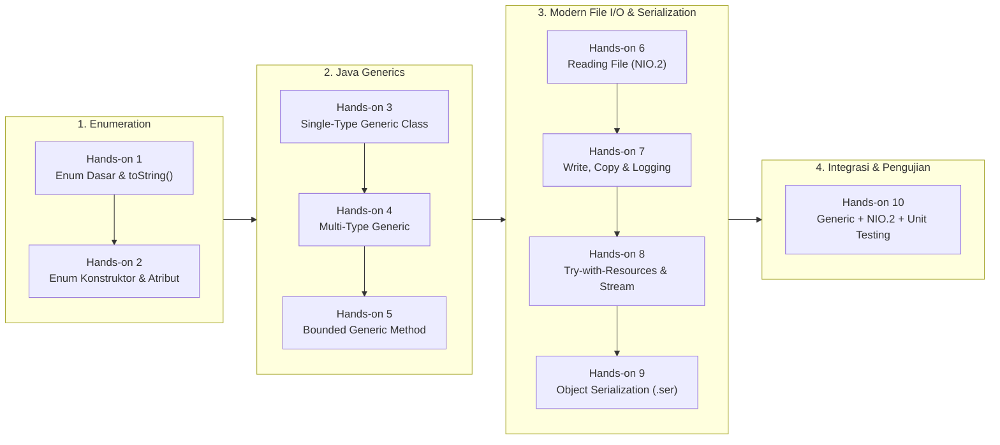

<div align="center">

# ☕ Hands-On: Generics, Enumeration, & Input/Output (Java)

[](https://www.oracle.com/java/)
[](#)
[](#)
[](#)
[](./docs/Modul_Hands_On_Generics_Enum_IO.pdf)

**Repositori Praktikum & Latihan Pemrograman Berorientasi Objek (OOP)**  
Implementasi lengkap **Hands-on 1 hingga Hands-on 10** mencakup konsep **Enumeration**, **Java Generics**, **File I/O (Java NIO.2)**, **Try-with-Resources**, **Object Serialization**, dan **Unit Testing**.

[📄 **Lihat Modul Soal (PDF)**](./docs/Modul_Hands_On_Generics_Enum_IO.pdf) · [📂 **Struktur Proyek**](#-struktur-direktori-proyek) · [🚀 **Cara Menjalankan**](#-panduan-kompilasi--eksekusi) · [📘 **Dokumentasi Hands-On 1–10**](#-eksplorasi-interaktif-hands-on-1--10)

</div>

---

## 📌 Daftar Isi

- [🗺️ Peta Konsep & Arsitektur Pembelajaran](#️-peta-konsep--arsitektur-pembelajaran)
- [📄 Dokumen Modul Praktikum (PDF)](#-dokumen-modul-praktikum-pdf)
- [📊 Ringkasan Navigasi Hands-On (1–10)](#-ringkasan-navigasi-hands-on-110)
- [📂 Struktur Direktori Proyek](#-struktur-direktori-proyek)
- [📘 Eksplorasi Interaktif Hands-On 1 – 10](#-eksplorasi-interaktif-hands-on-1--10)
  - [Hands-on 1: Enum: Tipe Bank Account](#1️⃣-enum-tipe-bank-account-hands-on-1)
  - [Hands-on 2: Enum dengan Konstruktor](#2️⃣-enum-dengan-konstruktor-hands-on-2)
  - [Hands-on 3: Generic Class](#3️⃣-generic-class-hands-on-3)
  - [Hands-on 4: Generic Class Multi-Tipe](#4️⃣-generic-class-multi-tipe-hands-on-4)
  - [Hands-on 5: Generic Method](#5️⃣-generic-method-hands-on-5)
  - [Hands-on 6: Reading Text File (Pre vs NIO.2)](#6️⃣-reading-text-file-pre-vs-nio2-hands-on-6)
  - [Hands-on 7: Write and Copy Files](#7️⃣-write-and-copy-files-hands-on-7)
  - [Hands-on 8: Try-with-Resources & Stream](#8️⃣-try-with-resources--stream-hands-on-8)
  - [Hands-on 9: Serialization](#9️⃣-serialization-hands-on-9)
  - [Hands-on 10: Unit Testing (JUnit)](#🔟-unit-testing-junit-hands-on-10)
- [🚀 Panduan Kompilasi & Eksekusi](#-panduan-kompilasi--eksekusi)

---

## 🗺️ Peta Konsep & Arsitektur Pembelajaran

Diagram berikut menggambarkan alur materi yang dipelajari dan diimplementasikan dari **Hands-on 1** hingga **Hands-on 10**:



---

## 📄 Dokumen Modul Praktikum (PDF)

File modul asli yang berisi deskripsi kasus, perbandingan kode *Sebelum* vs *Sesudah Implementasi*, serta instruksi *Latihan* tersimpan di dalam folder [`docs/`](./docs):

> [!IMPORTANT]
> **Unduh / Baca Modul Soal Lengkap:**  
> 👉 [**`docs/Modul_Hands_On_Generics_Enum_IO.pdf`**](./docs/Modul_Hands_On_Generics_Enum_IO.pdf)

---

## 📊 Ringkasan Navigasi Hands-On (1–10)

Klik pada tautan **Folder** atau **Source Code** di tabel berikut untuk langsung menuju ke kode program masing-masing modul:

| No | Topik Hands-On | Konsep Utama | Direktori Modul | Kode Sumber (`src/`) | Data / Output (`data/`) |
|:--:|:---|:---|:---|:---|:---|
| **01** | **Enum: Tipe Bank Account** | `enum`, `values()`, Override `toString()` | [📂 Folder](./Enum%EF%BC%9A%20Tipe%20Bank%20Account%20(Hands-on%201)) | [`Account.java`](./Enum%EF%BC%9A%20Tipe%20Bank%20Account%20(Hands-on%201)/src/Account.java) | — |
| **02** | **Enum dengan Konstruktor** | Private Constructor, Field `code` & `interestRate` | [📂 Folder](./Enum%20dengan%20Konstruktor%20(Hands-on%202)) | [`EnumConstructorDemo.java`](./Enum%20dengan%20Konstruktor%20(Hands-on%202)/src/EnumConstructorDemo.java) | — |
| **03** | **Generic Class** | Type Parameter `<T>`, Compile-Time Type Safety | [📂 Folder](./Generic%20Class%20(Hands-on%203)) | [`Cell.java`](./Generic%20Class%20(Hands-on%203)/src/Cell.java) | — |
| **04** | **Generic Class Multi-Tipe** | Multi-Type `<T1, T2>`, Method `swap()` | [📂 Folder](./Generic%20Class%20Multi-Tipe%20(Hands-on%204)) | [`Pair.java`](./Generic%20Class%20Multi-Tipe%20(Hands-on%204)/src/Pair.java) | — |
| **05** | **Generic Method** | `<T extends Comparable<T>>`, Type Inference | [📂 Folder](./Generic%20Method%20(Hands-on%205)) | [`CompareUtil.java`](./Generic%20Method%20(Hands-on%205)/src/CompareUtil.java) | — |
| **06** | **Reading Text File (Pre vs NIO.2)** | `Path`, `Files.newBufferedReader`, `ArrayList` | [📂 Folder](./Reading%20Text%20File%20(Pre%20vs%20NIO.2)%20(Hands-on%206)) | [`ReadEmployeeFile.java`](./Reading%20Text%20File%20(Pre%20vs%20NIO.2)%20(Hands-on%206)/src/ReadEmployeeFile.java) | [`employees.txt`](./Reading%20Text%20File%20(Pre%20vs%20NIO.2)%20(Hands-on%206)/data/employees.txt)<br>[`copy_employees.txt`](./Reading%20Text%20File%20(Pre%20vs%20NIO.2)%20(Hands-on%206)/data/copy_employees.txt) |
| **07** | **Write and Copy Files** | `Files.write`, `Files.exists`, `Files.copy`, Logging | [📂 Folder](./Write%20and%20Copy%20Files%20(Hands-on%207)) | [`FileCopyNew.java`](./Write%20and%20Copy%20Files%20(Hands-on%207)/src/FileCopyNew.java) | [`report.txt`](./Write%20and%20Copy%20Files%20(Hands-on%207)/data/report.txt)<br>[`log.txt`](./Write%20and%20Copy%20Files%20(Hands-on%207)/data/log.txt) |
| **08** | **Try-with-Resources & Stream** | Auto-Closeable Resource, Loop `exit`, Timestamp | [📂 Folder](./Try-with-Resources%20&%20Stream%20(Hands-on%208)) | [`WriteUserInputNew.java`](./Try-with-Resources%20&%20Stream%20(Hands-on%208)/src/WriteUserInputNew.java) | [`user_input.txt`](./Try-with-Resources%20&%20Stream%20(Hands-on%208)/data/user_input.txt) |
| **09** | **Serialization** | `Serializable`, `ObjectOutputStream`, `deserialize()` | [📂 Folder](./Serialization%20(Hands-on%209)) | [`SerializeDemo.java`](./Serialization%20(Hands-on%209)/src/SerializeDemo.java) | [`emp.ser`](./Serialization%20(Hands-on%209)/data/emp.ser)<br>[`employees_list.ser`](./Serialization%20(Hands-on%209)/data/employees_list.ser) |
| **10** | **Unit Testing (JUnit)** | `Produk<T, U, V>`, `Files.readAllLines`, Unit Test | [📂 Folder](./Unit%20Testing%20(JUnit)%20(Hands-on%2010)) | [`ProdukWriterNew.java`](./Unit%20Testing%20(JUnit)%20(Hands-on%2010)/src/ProdukWriterNew.java)<br>[`ProdukWriterTest.java`](./Unit%20Testing%20(JUnit)%20(Hands-on%2010)/src/ProdukWriterTest.java) | [`produk_output.txt`](./Unit%20Testing%20(JUnit)%20(Hands-on%2010)/data/produk_output.txt)<br>[`pelanggan_output.txt`](./Unit%20Testing%20(JUnit)%20(Hands-on%2010)/data/pelanggan_output.txt)<br>[`transaksi_output.txt`](./Unit%20Testing%20(JUnit)%20(Hands-on%2010)/data/transaksi_output.txt) |

---

## 📂 Struktur Direktori Proyek

Setiap modul dirancang secara **modular** dan **bersih**, memisahkan kode sumber (`src/`), hasil kompilasi bytecode (`out/`), dan berkas input/output (`data/`):

```text
📦 Hands On Generic Input Output
 ┣ 📂 docs
 ┃ ┗ 📄 Modul_Hands_On_Generics_Enum_IO.pdf          # Modul soal asli (PDF)
 ┣ 📂 Enum： Tipe Bank Account (Hands-on 1)
 ┃ ┣ 📂 src
 ┃ ┃ ┗ 📄 Account.java
 ┃ ┗ 📂 out                                          # Bytecode (.class)
 ┣ 📂 Enum dengan Konstruktor (Hands-on 2)
 ┃ ┣ 📂 src
 ┃ ┃ ┗ 📄 EnumConstructorDemo.java
 ┃ ┗ 📂 out
 ┣ 📂 Generic Class (Hands-on 3)
 ┃ ┣ 📂 src
 ┃ ┃ ┗ 📄 Cell.java
 ┃ ┗ 📂 out
 ┣ 📂 Generic Class Multi-Tipe (Hands-on 4)
 ┃ ┣ 📂 src
 ┃ ┃ ┗ 📄 Pair.java
 ┃ ┗ 📂 out
 ┣ 📂 Generic Method (Hands-on 5)
 ┃ ┣ 📂 src
 ┃ ┃ ┗ 📄 CompareUtil.java
 ┃ ┗ 📂 out
 ┣ 📂 Reading Text File (Pre vs NIO.2) (Hands-on 6)
 ┃ ┣ 📂 src
 ┃ ┃ ┗ 📄 ReadEmployeeFile.java
 ┃ ┣ 📂 data
 ┃ ┃ ┣ 📄 employees.txt
 ┃ ┃ ┗ 📄 copy_employees.txt
 ┃ ┗ 📂 out
 ┣ 📂 Write and Copy Files (Hands-on 7)
 ┃ ┣ 📂 src
 ┃ ┃ ┗ 📄 FileCopyNew.java
 ┃ ┣ 📂 data
 ┃ ┃ ┣ 📂 backup
 ┃ ┃ ┃ ┗ 📄 report.txt
 ┃ ┃ ┣ 📄 report.txt
 ┃ ┃ ┗ 📄 log.txt
 ┃ ┗ 📂 out
 ┣ 📂 Try-with-Resources & Stream (Hands-on 8)
 ┃ ┣ 📂 src
 ┃ ┃ ┗ 📄 WriteUserInputNew.java
 ┃ ┣ 📂 data
 ┃ ┃ ┗ 📄 user_input.txt
 ┃ ┗ 📂 out
 ┣ 📂 Serialization (Hands-on 9)
 ┃ ┣ 📂 src
 ┃ ┃ ┗ 📄 SerializeDemo.java
 ┃ ┣ 📂 data
 ┃ ┃ ┣ 📄 emp.ser
 ┃ ┃ ┗ 📄 employees_list.ser
 ┃ ┗ 📂 out
 ┣ 📂 Unit Testing (JUnit) (Hands-on 10)
 ┃ ┣ 📂 src
 ┃ ┃ ┣ 📄 ProdukWriterNew.java
 ┃ ┃ ┗ 📄 ProdukWriterTest.java
 ┃ ┣ 📂 data
 ┃ ┃ ┣ 📄 produk_output.txt
 ┃ ┃ ┣ 📄 pelanggan_output.txt
 ┃ ┃ ┗ 📄 transaksi_output.txt
 ┃ ┗ 📂 out
 ┗ 📄 README.md                                      # Dokumentasi Utama
```

---

## 📘 Eksplorasi Interaktif Hands-On 1 – 10

> [!TIP]
> **Fitur Interaktif:** Klik pada bar **`▶ Lihat Detail Kode, Transformasi & Output ...`** di bawah masing-masing bagian untuk membuka/menutup pembahasan kode lengkap dan hasil eksekusi konsolnya!

---

### 1️⃣ Enum: Tipe Bank Account (Hands-on 1)

- **Deskripsi Kasus:** Sistem perbankan memiliki tipe akun `SAVINGS` dan `CREDIT`. Sebelum menggunakan `enum`, tipe disimpan sebagai `String` yang rentan terhadap kesalahan ketik (*typo*).
- **Target Latihan:**
  - [x] Tambahkan `DEPOSIT` sebagai tipe baru.
  - [x] Buat `toString()` agar menampilkan teks deskriptif.
  - [x] Uji di `main()` dengan mencetak semua tipe enum.

<details>
<summary><b>▶ Lihat Transformasi Kode & Output Konsol (Hands-on 1)</b></summary>
<br>

**Perbandingan Sebelum vs Sesudah:**
```java
// ❌ SEBELUM: Rentan typo karena menggunakan String bebas
public class Account {
    private String type;
    public Account(String type) { this.type = type; }
}

// ✅ SESUDAH: Type-safe dengan Enum + DEPOSIT & deskripsi toString()
enum AccountType {
    SAVINGS {
        @Override
        public String toString() { return "Savings Account (Rekening Tabungan)"; }
    },
    CREDIT {
        @Override
        public String toString() { return "Credit Account (Rekening Kredit)"; }
    },
    DEPOSIT {
        @Override
        public String toString() { return "Deposit Account (Rekening Deposito)"; }
    }
}
```

**Output Program (`Account.java`):**
```text
=== Hands-on 1: Enum: Tipe Bank Account ===

Daftar Semua Tipe Enum:
- SAVINGS -> Savings Account (Rekening Tabungan)
- CREDIT -> Credit Account (Rekening Kredit)
- DEPOSIT -> Deposit Account (Rekening Deposito)

Uji Objek Account:
Account [Tipe = SAVINGS, Deskripsi = Savings Account (Rekening Tabungan)]
Account [Tipe = CREDIT, Deskripsi = Credit Account (Rekening Kredit)]
Account [Tipe = DEPOSIT, Deskripsi = Deposit Account (Rekening Deposito)]
```
🔗 **File Sumber:** [`Enum： Tipe Bank Account (Hands-on 1)/src/Account.java`](./Enum%EF%BC%9A%20Tipe%20Bank%20Account%20(Hands-on%201)/src/Account.java)
</details>

---

### 2️⃣ Enum dengan Konstruktor (Hands-on 2)

- **Deskripsi Kasus:** Setiap tipe akun memiliki kode internal bank (`SAVINGS → SA`, `CREDIT → CR`, `DEPOSIT → DP`) serta suku bunga masing-masing.
- **Target Latihan:**
  - [x] Tambahkan atribut `interestRate`.
  - [x] Tampilkan nama, kode, dan suku bunga.
  - [x] Buat loop menampilkan semua tipe beserta kodenya.

<details>
<summary><b>▶ Lihat Implementasi Kode & Output Konsol (Hands-on 2)</b></summary>
<br>

**Cuplikan Implementasi (`EnumConstructorDemo.java`):**
```java
enum AccountType {
    SAVINGS("SA", 2.5),
    CREDIT("CR", 15.0),
    DEPOSIT("DP", 5.5);

    private String code;
    private double interestRate;

    private AccountType(String code, double interestRate) {
        this.code = code;
        this.interestRate = interestRate;
    }

    public String getCode() { return code; }
    public double getInterestRate() { return interestRate; }
}
```

**Output Program:**
```text
=== Hands-on 2: Enum dengan Konstruktor ===
Nama: SAVINGS    | Kode: SA   | Suku Bunga: 2.50%
Nama: CREDIT     | Kode: CR   | Suku Bunga: 15.00%
Nama: DEPOSIT    | Kode: DP   | Suku Bunga: 5.50%
```
🔗 **File Sumber:** [`Enum dengan Konstruktor (Hands-on 2)/src/EnumConstructorDemo.java`](./Enum%20dengan%20Konstruktor%20(Hands-on%202)/src/EnumConstructorDemo.java)
</details>

---

### 3️⃣ Generic Class (Hands-on 3)

- **Deskripsi Kasus:** Class `Cell` awalnya hanya bisa menyimpan `String`. Dengan **Generic Class** `Cell<T>`, class menjadi fleksibel untuk menyimpan berbagai tipe data secara aman.
- **Target Latihan:**
  - [x] Buat `Cell<Integer>` dan `Cell<String>` di `main()`.
  - [x] Tambahkan method `displayType()` untuk menampilkan tipe data.
  - [x] Jelaskan keuntungan penggunaan *generic type safety*.

<details>
<summary><b>▶ Lihat Jawaban Konsep, Kode & Output Konsol (Hands-on 3)</b></summary>
<br>

**💡 Jawaban: Keuntungan Penggunaan Generic Type Safety**
1. **Deteksi Kesalahan Saat Kompilasi (*Compile-Time Type Checking*):** Kesalahan memasukkan tipe data (misalnya memasukkan `String` ke `Cell<Integer>`) langsung tertangkap oleh *compiler* sebelum program dijalankan, mencegah `ClassCastException` saat *runtime*.
2. **Menghilangkan Kebutuhan *Explicit Type Casting*:** Tidak perlu melakukan *casting* manual seperti `(Integer) cell.getValue()`.
3. **Reusabilitas Kode (*Code Reusability*):** Satu definisi class `Cell<T>` dapat digunakan untuk tipe data apa pun (`Integer`, `String`, `Double`, objek kustom, dll.).

**Output Program (`Cell.java`):**
```text
=== Hands-on 3: Generic Class ===
Tipe data: java.lang.Integer | Nilai: 100
Tipe data: java.lang.String | Nilai: Belajar Java Generics
```
🔗 **File Sumber:** [`Generic Class (Hands-on 3)/src/Cell.java`](./Generic%20Class%20(Hands-on%203)/src/Cell.java)
</details>

---

### 4️⃣ Generic Class Multi-Tipe (Hands-on 4)

- **Deskripsi Kasus:** Membuat class `Pair<T1, T2>` yang dapat menyimpan dua objek dengan tipe data berbeda sekaligus (misalnya ID dan Nama, atau Skor dan Status Kelulusan).
- **Target Latihan:**
  - [x] Buat `Pair<Integer, String>` dan `Pair<Double, Boolean>`.
  - [x] Tambahkan method `swap()` untuk menukar nilai.

<details>
<summary><b>▶ Lihat Implementasi Method swap() & Output Konsol (Hands-on 4)</b></summary>
<br>

**Implementasi Method `swap()`:**
```java
// Mengembalikan objek Pair baru dengan urutan tipe dan nilai yang ditukar (Pair<T2, T1>)
public Pair<T2, T1> swap() {
    return new Pair<>(this.second, this.first);
}
```

**Output Program (`Pair.java`):**
```text
=== Hands-on 4: Generic Class Multi-Tipe ===
Sebelum swap pair1 : Pair(101, Budi Santoso)
Tipe: java.lang.Integer & java.lang.String
Sesudah swap pair1 : Pair(Budi Santoso, 101)
Tipe: java.lang.String & java.lang.Integer

Sebelum swap pair2 : Pair(98.5, true)
Tipe: java.lang.Double & java.lang.Boolean
Sesudah swap pair2 : Pair(true, 98.5)
Tipe: java.lang.Boolean & java.lang.Double
```
🔗 **File Sumber:** [`Generic Class Multi-Tipe (Hands-on 4)/src/Pair.java`](./Generic%20Class%20Multi-Tipe%20(Hands-on%204)/src/Pair.java)
</details>

---

### 5️⃣ Generic Method (Hands-on 5)

- **Deskripsi Kasus:** Membuat metode pembanding tunggal `<T extends Comparable<T>> boolean isEqual(T a, T b)` yang dapat membandingkan dua nilai dengan tipe apa pun tanpa duplikasi kode `isEqualInt`, `isEqualString`, dsb.
- **Target Latihan:**
  - [x] Tambahkan *test case* untuk `Double` dan `Character`.
  - [x] Jelaskan perbedaan antara *generic class* dan *generic method*.

<details>
<summary><b>▶ Lihat Perbedaan Konsep & Output Konsol (Hands-on 5)</b></summary>
<br>

**💡 Jawaban: Perbedaan Generic Class vs Generic Method**

| Aspek | Generic Class (`class Cell<T>`) | Generic Method (`<T> boolean isEqual(T a, T b)`) |
|:---|:---|:---|
| **Cakupan (*Scope*)** | Parameter tipe `<T>` berlaku di seluruh atribut dan *non-static method* dalam class. | Parameter tipe `<T>` hanya berlaku lokal di dalam method tempat ia dideklarasikan. |
| **Method `static`** | Parameter tipe class tidak bisa digunakan oleh `static` method. | Dapat dideklarasikan sebagai `static` method secara mandiri. |
| **Pemanggilan** | Tipe ditentukan saat membuat instance class (`new Cell<Integer>()`). | Tipe dikenali otomatis (*type inference*) dari argumen saat method dipanggil (`isEqual('A', 'A')`). |

**Output Program (`CompareUtil.java`):**
```text
=== Hands-on 5: Generic Method ===
Integer (5, 5)           : true
String ("Hello", "World"): false
Double (3.14, 3.14)      : true
Double (3.14, 2.71)      : false
Character ('A', 'A')     : true
Character ('A', 'B')     : false
```
🔗 **File Sumber:** [`Generic Method (Hands-on 5)/src/CompareUtil.java`](./Generic%20Method%20(Hands-on%205)/src/CompareUtil.java)
</details>

---

### 6️⃣ Reading Text File (Pre vs NIO.2) (Hands-on 6)

- **Deskripsi Kasus:** Membaca daftar karyawan dari `employees.txt` menggunakan API modern `java.nio.file` (`Path`, `Paths`, `Files.newBufferedReader`) dan menyalinnya ke file baru.
- **Target Latihan:**
  - [x] Tambahkan deteksi jika file tidak ditemukan (`Files.notExists()`).
  - [x] Simpan hasil baca ke `ArrayList<String>`.
  - [x] Tuliskan ke file baru `copy_employees.txt`.

<details>
<summary><b>▶ Lihat Alur Program & Output Konsol (Hands-on 6)</b></summary>
<br>

**Output Program (`ReadEmployeeFile.java`):**
```text
=== Hands-on 6: Reading Text File (NIO.2) ===
Berhasil membaca 4 baris dari data\employees.txt:
 - 101, Andi Pratama, IT Department
 - 102, Siti Aminah, Finance
 - 103, Budi Santoso, Human Resources
 - 104, Dewi Lestari, Marketing

Data berhasil disalin ke file baru: data\copy_employees.txt
```
🔗 **File Sumber:** [`Reading Text File (Pre vs NIO.2) (Hands-on 6)/src/ReadEmployeeFile.java`](./Reading%20Text%20File%20(Pre%20vs%20NIO.2)%20(Hands-on%206)/src/ReadEmployeeFile.java)
</details>

---

### 7️⃣ Write and Copy Files (Hands-on 7)

- **Deskripsi Kasus:** Menyimpan laporan ke `report.txt`, membuat folder cadangan secara otomatis, menyalinnya ke `backup/report.txt` menggunakan `Files.copy()`, dan mencatat seluruh aktivitas ke `log.txt`.
- **Target Latihan:**
  - [x] Tambahkan pengecekan file sebelum menyalin (`Files.exists()`).
  - [x] Buat log hasil operasi ke file `log.txt`.

<details>
<summary><b>▶ Lihat Isi Log & Output Konsol (Hands-on 7)</b></summary>
<br>

**Output Program & Isi `data/log.txt`:**
```text
=== Hands-on 7: Write and Copy Files (NIO.2) ===
[2026-11-13 15:46:54] INFO: File sumber 'data/report.txt' berhasil dibuat.
[2026-11-13 15:46:54] INFO: Pengecekan Files.exists(source) bernilai TRUE. Melanjutkan proses salin.
[2026-11-13 15:46:54] INFO: Direktori 'data\backup' berhasil dibuat.
[2026-11-13 15:46:54] SUCCESS: Backup berhasil dibuat di 'data\backup\report.txt'.
Log operasi berhasil disimpan ke: data\log.txt
```
🔗 **File Sumber:** [`Write and Copy Files (Hands-on 7)/src/FileCopyNew.java`](./Write%20and%20Copy%20Files%20(Hands-on%207)/src/FileCopyNew.java)
</details>

---

### 8️⃣ Try-with-Resources & Stream (Hands-on 8)

- **Deskripsi Kasus:** Meminta input teks interaktif dari pengguna dan menyimpannya ke file menggunakan blok `try (Scanner ...; BufferedWriter ...)` sehingga *resource* tertutup otomatis tanpa risiko *resource leak*.
- **Target Latihan:**
  - [x] Ubah agar menulis beberapa baris hingga pengguna mengetik `exit`.
  - [x] Tambahkan *timestamp* pada setiap baris input.

<details>
<summary><b>▶ Lihat Contoh Input/Output & File Hasil (Hands-on 8)</b></summary>
<br>

**Isi File `data/user_input.txt` yang Dihasilkan:**
```text
[2026-11-13 15:46:54] Baris pertama
[2026-11-13 15:46:54] Baris kedua
```
🔗 **File Sumber:** [`Try-with-Resources & Stream (Hands-on 8)/src/WriteUserInputNew.java`](./Try-with-Resources%20&%20Stream%20(Hands-on%208)/src/WriteUserInputNew.java)
</details>

---

### 9️⃣ Serialization (Hands-on 9)

- **Deskripsi Kasus:** Menyimpan state objek `Employee` secara permanen ke file biner (`.ser`) menggunakan `ObjectOutputStream` dan membacanya kembali tanpa perlu *parsing* teks manual.
- **Target Latihan:**
  - [x] Tambahkan method `deserialize()` untuk membaca kembali objek.
  - [x] Uji dengan beberapa objek berbeda.

<details>
<summary><b>▶ Lihat Implementasi deserialize() & Output Konsol (Hands-on 9)</b></summary>
<br>

**Output Program (`SerializeDemo.java`):**
```text
=== Hands-on 9: Serialization ===
Serialized successfully to data/emp.ser
Deserialized single object: John, 30

--- Uji dengan Beberapa Objek Berbeda ---
Serialized successfully to data/employees_list.ser
Deserialized multiple objects:
 - Employee{name='John', age=30}
 - Employee{name='Alice', age=25}
 - Employee{name='Bob', age=40}
 - Employee{name='Siti', age=28}
```
🔗 **File Sumber:** [`Serialization (Hands-on 9)/src/SerializeDemo.java`](./Serialization%20(Hands-on%209)/src/SerializeDemo.java)
</details>

---

### 🔟 Unit Testing (JUnit) (Hands-on 10)

- **Deskripsi Kasus:** Menggabungkan **Generic Class** dan **Java NIO.2** untuk menyimpan berbagai daftar entitas (Produk, Pelanggan, Transaksi) ke file teks, membacanya kembali dengan `Files.readAllLines()`, serta memvalidasi kebenaran fungsinya melalui **Unit Testing**.
- **Target Latihan:**
  - [x] Tambahkan atribut `stok` ke dalam class `Produk` (gunakan tipe data `Integer`).
  - [x] Ubah program agar dapat membaca kembali isi file (`Files.readAllLines()`) dan menampilkannya di konsol.
  - [x] Modifikasi class agar bisa digunakan untuk menyimpan jenis data lain (pelanggan dan transaksi).

<details>
<summary><b>▶ Lihat Output Program & Hasil Unit Test (Hands-on 10)</b></summary>
<br>

**Output Program (`ProdukWriterNew.java`):**
```text
=== Hands-on 10: Generic Class + NIO.2 & Unit Testing ===
Data produk berhasil disimpan menggunakan NIO.2 ke data\produk_output.txt

Isi file data\produk_output.txt (Nama,Harga,Stok):
 - Laptop,1.5E7,10
 - Mouse,150000.0,50
 - Keyboard,350000.0,30

--- Menyimpan Jenis Data Lain (Pelanggan & Transaksi) ---

Isi file data\pelanggan_output.txt (ID,Nama,MemberAktif):
 - 1001,Andi Pratama,true
 - 1002,Siti Aminah,false

Isi file data\transaksi_output.txt (KodeTransaksi,Total,JumlahItem):
 - TRX-2026-01,1.515E7,2
 - TRX-2026-02,350000.0,1
```

**Output Unit Testing (`ProdukWriterTest.java`):**
```text
=== Menjalankan Unit Testing Hands-on 10 ===
[PASS] testProdukToString
[PASS] testSimpanDanBacaFileProduk
[PASS] testSimpanDataPelanggan
Semua Unit Test BERHASIL (3/3 passed)!
```
🔗 **File Sumber:**
- [`Unit Testing (JUnit) (Hands-on 10)/src/ProdukWriterNew.java`](./Unit%20Testing%20(JUnit)%20(Hands-on%2010)/src/ProdukWriterNew.java)
- [`Unit Testing (JUnit) (Hands-on 10)/src/ProdukWriterTest.java`](./Unit%20Testing%20(JUnit)%20(Hands-on%2010)/src/ProdukWriterTest.java)
</details>

---

## 🚀 Panduan Kompilasi & Eksekusi

### Menjalankan Satu Modul Tertentu
Buka terminal (PowerShell / Command Prompt / Bash), masuk ke direktori Hands-on yang diinginkan, kompilasi kode dari `src/` ke `out/`, lalu jalankan:

```powershell
# Contoh menjalankan Hands-on 10 beserta Unit Test-nya:
cd "Unit Testing (JUnit) (Hands-on 10)"
javac -d out src/*.java
java -cp out ProdukWriterNew
java -cp out ProdukWriterTest
```

### Menjalankan Seluruh Hands-on (1–10) Sekaligus di PowerShell
Salin dan jalankan perintah berikut dari *root directory* repositori:

```powershell
Get-ChildItem -Directory -Exclude "docs" | ForEach-Object {
    Push-Location $_.FullName
    javac -d out src/*.java
    Pop-Location
}
```

---

<div align="center">
  <sub>Disusun untuk Tugas & Praktikum <b>Object Oriented Programming (OOP)</b> — Universitas Hasanuddin</sub>
</div>
